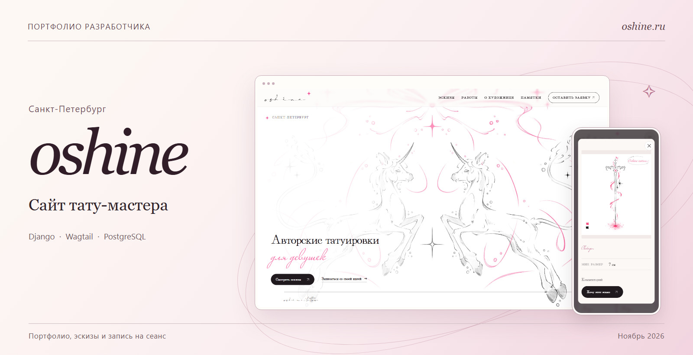
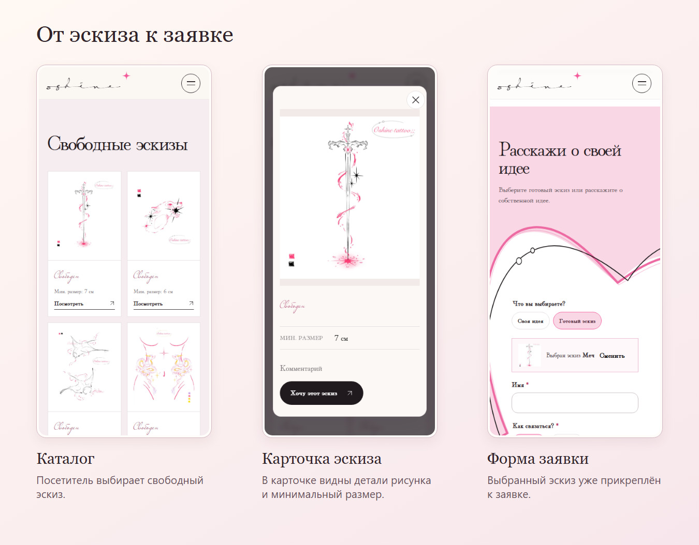
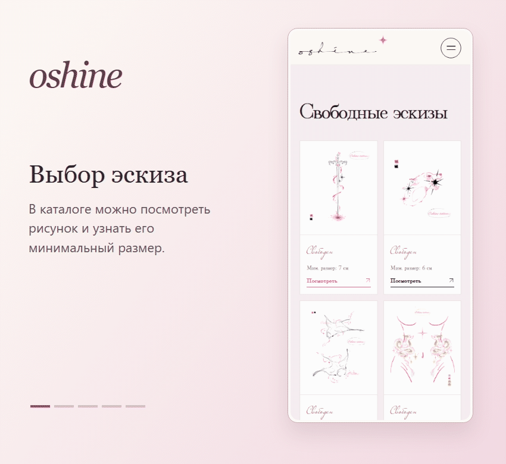
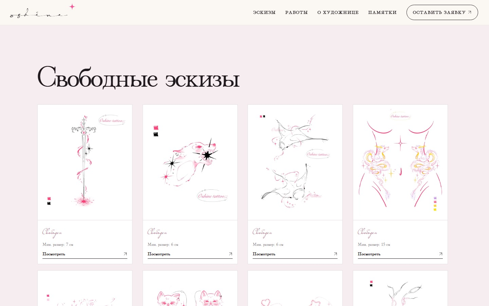

# oshine · сайт тату-мастера

Художница oshine из Санкт-Петербурга публикует свободные эскизы и фотографии выполненных татуировок. Посетитель может выбрать рисунок или предложить свою идею. В Telegram мастер получает заявку вместе с эскизом, пожеланиями и референсами клиента.

[**Открыть сайт ↗**](https://oshine.ru/) &nbsp;·&nbsp; [**Посмотреть запись на сеанс в GIF**](assets/booking.gif)

## От эскиза к заявке

В каталоге у каждого эскиза видны доступность и минимальный размер. Кнопка «Хочу этот эскиз» переносит выбранный рисунок в форму. Клиенту остаётся указать место нанесения, размер и способ связи. Для индивидуальной татуировки есть отдельный сценарий со своей идеей.

<strong>Посмотреть отправку тестовой заявки</strong>

Демонстрация записана на локальной копии сайта с вымышленными контактами. Последний кадр показывает подтверждение, которое клиент видит после отправки.

## Как мастер ведёт портфолио

В Wagtail художница сама добавляет фотографии и меняет статус эскиза. Когда татуировка выполнена, из эскиза можно создать черновик работы, добавить фотографии результата и опубликовать его в портфолио.

## Разработка

| Часть проекта | Как устроена |
| --- | --- |
| Интерфейс | Адаптивные шаблоны Django. Галереи поддерживают управление с клавиатуры и листание на телефоне. |
| Контент | Wagtail связывает эскизы, выполненные работы и заявки. Мастер редактирует галереи и памятки через CMS. |
| Заявки | Django сохраняет заявку и задание на уведомление в одной транзакции PostgreSQL. Повторная отправка той же формы защищена от дублей. |
| Уведомления | Фоновый процесс передаёт мастеру детали заявки и изображения через Telegram. При временном сбое он повторяет попытку. |
| Файлы | Фотографии портфолио доступны посетителям. У прикреплённых клиентом референсов отдельное хранилище и проверка прав при открытии через CMS. |
| Развёртывание | Docker, Gunicorn и Nginx на Ubuntu. Публичный сайт запущен 10 ноября 2026 года. |

Исходный код приложения закрыт.
